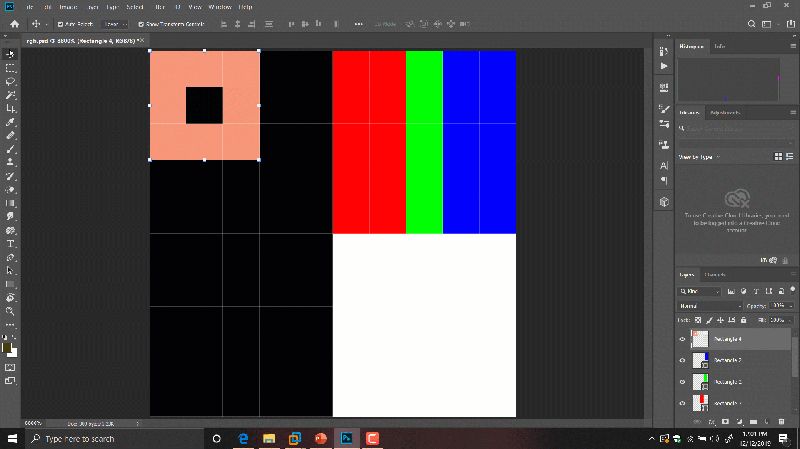

# Taller · Benchmarking de código C++ paralelo generado por IA (OpenMP)

**Autores:** Jose Barrera Ramos · Miguel Padilla · Esteban Serrano

**Programación Paralela — Pontificia Universidad Javeriana Cali**

Este paquete permite repetir el experimento del taller **desde cualquier PC**
(Windows, macOS o Linux) **sin instalar C++ ni OpenMP**: todo se compila y se
ejecuta dentro de **Docker**. Incluye las cuatro variantes del filtro, el
programa de medición, los scripts que automatizan la corrida y la evaluación
(tablas + gráficas).

Si nunca has usado Docker ni una terminal, no pasa nada. Sigue la guía en orden
y copia los comandos tal cual.

> **Los comandos de esta guía están escritos para el Símbolo del sistema
> (`cmd.exe`) de Windows.** En macOS/Linux funciona igual salvo el cambio de
> carpeta (`$PWD` en lugar de `%cd%`). Si usas PowerShell, mira la
> [sección 15](#15-comandos-para-powershell).

---

## Índice

1. [¿Qué hace este experimento?](#1-qué-hace-este-experimento)
2. [Versión corta (si ya sabes lo que haces)](#2-versión-corta-si-ya-sabes-lo-que-haces)
3. [Las cuatro variantes que se comparan](#3-las-cuatro-variantes-que-se-comparan)
4. [Qué se agregó al código base (el arnés de medición)](#4-qué-se-agregó-al-código-base-el-arnés-de-medición)
5. [Qué trae este paquete](#5-qué-trae-este-paquete)
6. [Requisitos: Docker y varios núcleos](#6-requisitos-docker-y-varios-núcleos)
7. [Antes de empezar (checklist)](#7-antes-de-empezar-checklist)
8. [Paso a paso con Docker (recomendado)](#8-paso-a-paso-con-docker-recomendado)
9. [Paso a paso manual (programa por programa)](#9-paso-a-paso-manual-programa-por-programa)
10. [Cómo leer los resultados](#10-cómo-leer-los-resultados)
11. [Resultados de referencia](#11-resultados-de-referencia)
12. [Cómo ajustar o reemplazar tus variantes](#12-cómo-ajustar-o-reemplazar-tus-variantes)
13. [Problemas frecuentes](#13-problemas-frecuentes)
14. [Transparencia sobre el uso de IA](#14-transparencia-sobre-el-uso-de-ia)
15. [Comandos para PowerShell](#15-comandos-para-powershell)
16. [Mini glosario de terminal](#16-mini-glosario-de-terminal)

---

## 1. ¿Qué hace este experimento?

El objetivo del taller es medir **cuánto mejora el rendimiento al paralelizar**
un filtro de imágenes y comparar **código paralelo escrito por IA** contra
**código escrito a mano**.

El filtro es una **convolución 2D**: a cada píxel de la imagen se le aplica un
promedio ponderado de sus vecinos usando una matriz pequeña llamada *kernel*. En
este caso el kernel es un **filtro gaussiano** (desenfoque) cuyo *sigma* crece con
el tamaño del kernel.



Ejemplo del efecto (original y filtrada):


Según el enunciado del taller, se prueba **un solo conjunto de imágenes**
(la carpeta `Images/`) con todas las combinaciones de:

| Parámetro | Valores |
|---|---|
| Tamaño de imagen | 512×512, 1024×1024, 2048×2048, 4096×4096 px |
| Tamaño del kernel | 3×3, 5×5, 7×7, 11×11 |
| Número de hilos | 1, 2, 4, 8, 16 |
| Repeticiones por configuración | 30 |

Por cada configuración se mide **solo el tiempo del filtrado** (no el de leer o
guardar la imagen) y se calculan:

| Métrica | Fórmula | Qué significa |
|---|---|---|
| Tiempo | media de las 30 corridas, en ms | Cuánto tarda |
| Desviación estándar | de las 30 corridas | Qué tan estables fueron las mediciones |
| Speedup | Sp = T₁ / Tp | Cuántas veces más rápida que la secuencial |
| Eficiencia | Ep = Sp / p | Qué tan bien se aprovecha cada hilo (ideal = 1) |

Además, **cada resultado se valida**: el buffer RGB que produce cada versión
paralela se resume en un **checksum FNV-1a de 64 bits** que debe ser **idéntico**
al de la versión secuencial (equivalencia bit a bit). Si no coincide, se marca
como error y esa comparación de tiempos no es válida.

### 1.1 Qué mide cada programa

- Recorre **automáticamente** todas las imágenes de la carpeta `Images/` (no recibe
  argumentos).
- Aplica un kernel **gaussiano** de 3×3, 5×5, 7×7 y 11×11.
- Prueba los hilos **1, 2, 4, 8 y 16** (solo en las variantes paralelas; la
  secuencial siempre corre con 1).
- Hace **1 ejecución de calentamiento** (no cronometrada) + **30 repeticiones**
  cronometradas por configuración.
- Cronometra **solo la convolución** (no cargar/guardar la imagen).

---

## 2. Versión corta (si ya sabes lo que haces)

Los comandos de abajo son para **Windows (`cmd.exe`)**. En Linux/macOS funciona
igual, salvo el cambio de carpeta (`$PWD` en lugar de `%cd%`).

```cmd
REM 0) Situarse en la carpeta del proyecto
cd /d "C:\Users\JoseB\Desktop\Paralela\Benchmarking"

REM 1) Comprobar que Docker está encendido
docker info

REM 2) Construir la imagen (una sola vez; tarda unos minutos la primera vez)
docker build -t benchmark-paralelo .

REM 3) Prueba rápida (3 repeticiones)
docker run --rm -e BENCH_REPS=3 -v "%cd%\resultados:/resultados" benchmark-paralelo

REM 4) Corrida oficial (30 repeticiones, todas las variantes)
docker run --rm -v "%cd%\resultados:/resultados" benchmark-paralelo
```

Los resultados aparecen en la carpeta **`resultados/`** (un solo
`resultados.csv` con todas las variantes, más `combinado.csv`, `tablas.md`,
`resumen.txt` y `graficas/`).

---

## 3. Las cuatro variantes que se comparan

Las cuatro hacen **exactamente la misma operación** y producen **exactamente la
misma imagen** (mismo checksum). Lo único que cambia es cómo está escrito el
código.

| Variante | Nombre en los resultados | Archivo | Quién lo escribió |
|---|---|---|---|
| C++ Secuencial | `secuencial` | `secuencial.cpp` | A mano (línea base, 1 hilo) |
| C++ Paralelo IA | `paralelo_ia` | `paralelo_ia.cpp` | Generado por IA |
| C++ Paralelo IA + Opt. | `paralelo_ia_opt` | `paralelo_ia_opt.cpp` | IA + optimización posterior |
| C++ Paralelo Manual | `paralelo_manual` | `paralelo_manual.cpp` | A mano (adaptado de GitHub) |

> **Estado actual:** las **cuatro variantes ya están listas** y se compilan
> automáticamente (`CMake` detecta los `.cpp` que existan). Solo hay que construir
> la imagen y correr.

### 3.1 Secuencial (la base de referencia)

Un solo hilo. Es la **referencia T₁** con la que se calcula el speedup de todas
las demás y la que define el checksum "correcto". La estructura es:

```
para cada fila y de la imagen
  para cada columna x
    para cada canal c (R, G, B)
      acc = 0
      para cada fila ky del kernel
        para cada columna kx del kernel
          acc += pixel(y+ky, x+kx, c) * kernel(ky, kx)
      guardar redondeo(acc) limitado a 0–255
```

Detalles: kernel **gaussiano normalizado** (`sigma = 0.3*((k-1)*0.5 - 1) + 0.8`),
borde **replicado (clamp)** para que la salida tenga el mismo tamaño que la
entrada, y se procesan los **3 canales (RGB)**.

### 3.2 Paralelo IA

Se obtuvo pidiéndole a una IA que paralelizara el código secuencial con OpenMP,
manteniendo la firma y el resultado numérico. La estructura es idéntica a la
secuencial, pero reparte las **filas** de la imagen entre los hilos:

```cpp
#pragma omp parallel for schedule(static)
for (int y = 0; y < h; ++y) { ... }
```

Cada hilo procesa su grupo de filas de forma independiente, así que el resultado
sigue siendo idéntico.

### 3.3 Paralelo IA + Opt. (lista)

Parte de la versión de IA y aplica **dos optimizaciones** que suelen pasarse por
alto, sin cambiar el resultado:

1. **Inversión de bucles** para que el compilador pueda usar instrucciones
   **SIMD** (vectoriales). El bucle más interno recorre toda una fila (píxeles
   contiguos en memoria), cada uno con su propio acumulador:

   ```
   para cada fila y (repartido entre hilos)
     acum[] = 0                       (un acumulador por píxel de la fila)
     para cada fila ky del kernel
       para cada columna kx del kernel
         peso = kernel(ky, kx)
         para cada columna x          ← bucle largo, se puede vectorizar
           acum[x] += pixel(y+ky, x+kx) * peso
     guardar acum[x] limitado a 0–255
   ```

2. **Fusión de los canales RGB**: la secuencial lee el vecindario del kernel
   **3 veces** (una por canal); aquí se leen los 3 canales de un píxel **de una
   sola vez** y se acumulan en paralelo, reduciendo los accesos a memoria.

Detalle importante: cada píxel y cada canal siguen sumando los taps en el
**mismo orden** (primero `ky`, luego `kx`) y en `float`, así que el resultado es
**idéntico bit a bit**.

### 3.4 Paralelo Manual (lista)

Es la versión "hecha a mano". Se adaptó el código de un **repositorio de GitHub**
de convolución al mismo contrato que las demás variantes, **conservando su
esencia**: la función `kernel_calc`, la función `convolution` con
`#pragma omp parallel for ... schedule(static, 2)` y `applyFilter` llamando canal
por canal.

- **Repositorio usado:** <https://github.com/ivandres73/Convolution.git>
- Localmente está en `ParaleloManualGithub/Convolution-master/` (incluye `CImg.h`,
  `main.cpp`, `timer.h`).

> El código original usaba kernel fijo 3×3, tamaño fijo (1080×720), sin borde, y
> sumaba en `unsigned short`. Se ajustó a: kernel dinámico (3/5/7/11) gaussiano
> normalizado, RGB, borde replicado, acumulación `float` en el mismo orden que la
> secuencial y la interfaz común (CSV, 30 repeticiones). El contrato completo está
> en **`PARALELO_MANUAL_SPEC.md`**.

---

## 4. Qué se agregó al código base (el arnés de medición)

Los **algoritmos** de convolución son el corazón del experimento, pero el
**programa que mide** es común a las cuatro variantes y vive dentro de cada
`.cpp`. No hay que instalarlo aparte: cada ejecutable ya trae su propio arnés.

En cada `.cpp` (variantes paralelas y secuencial) se agregó:

| Elemento | Para qué |
|---|---|
| Recorrido automático de imágenes | El programa **no recibe argumentos**; busca solo las imágenes de la carpeta |
| Generador de kernel gaussiano | Mismo kernel para todas las variantes (`sigma` paramétrico, normalizado) |
| 1 calentamiento + 30 repeticiones | Mide **solo la convolución** con `std::chrono` |
| Estadísticas | `media`, `stddev` (muestral), `min`, `max` |
| Checksum FNV-1a 64 | Valida la equivalencia estricta entre variantes |
| Impresión CSV | Una línea por configuración |

La interfaz se controla por **variables de entorno** (no hay que recompilar):

| Variable | Qué hace | Por defecto |
|---|---|---|
| `BENCH_DATASET` | Carpeta de imágenes a usar (ruta o nombre) | `Images` |
| `BENCH_REPS` | Repeticiones cronometradas | `30` |

Para que los checksums coincidan **bit a bit**, todas las variantes se compilan
con **`-ffp-contract=off`** (prohíbe la contracción a FMA) y con el mismo orden
de operaciones en `float`. Esto es lo que hace válida la comparación de tiempos.

---

## 5. Qué trae este paquete

```
Benchmarking/
├── README.md                    ← este archivo
├── TareaParalela.pdf            ← enunciado del taller
├── secuencial.cpp               ← variante secuencial
├── paralelo_ia.cpp              ← variante IA
├── paralelo_ia_opt.cpp          ← variante IA + Opt.
├── paralelo_manual.cpp          ← variante manual (adaptada de GitHub)
├── CMakeLists.txt               ← compilación (detecta las variantes presentes)
├── Dockerfile                   ← builder (compila) + runtime (ejecuta y evalúa)
├── docker-compose.yml           ← corrida con un solo comando
├── docker/
│   ├── run_all.sh               ← corre todas las variantes y llama a la evaluación
│   └── evaluar.py               ← combinado.csv, tablas.md y graficas/
├── third_party/                 ← stb_image.h / stb_image_write.h (leer/escribir imágenes)
├── Images/                       ← conjunto de imágenes: 512, 1024, 2048 y 4096 px
├── imgs/                        ← (material extra; ya no se usa en la corrida)
├── imagesForMarkDown/           ← imágenes explicativas (convolution.gif, etc.)
├── ParaleloManualGithub/        ← repositorio de origen de la variante manual
├── resultados/                  ← aquí aparecen TODOS los resultados
├── PARALELO_MANUAL_SPEC.md      ← contrato de la variante manual
└── PROCEDIMIENTO_Y_EVALUACION.md← sección de metodología/evaluación para el paper
```

---

## 6. Requisitos: Docker y varios núcleos

### 6.1 Sistema operativo

Cualquiera sirve: **Windows, macOS o Linux**. Lo único obligatorio es tener
**Docker Desktop** instalado y **abierto**.

- **Windows/macOS:** descarga Docker Desktop desde
  <https://www.docker.com/products/docker-desktop/> e instálalo.
- **Linux:** instala Docker Engine y asegúrate de que el usuario pueda usarlo
  (`sudo usermod -aG docker $USER` y reinicia la sesión).

> En Windows, Docker Desktop usa WSL2 por defecto. Es normal.

### 6.2 Abrir la terminal

- **Windows:** tecla Windows → escribe `cmd` → Enter (Símbolo del sistema).
- **macOS:** abre *Terminal* (en Aplicaciones → Utilidades).
- **Linux:** `Ctrl + Alt + T`.

### 6.3 Comprobar que Docker funciona

```cmd
docker info
```

Si muestra información del servidor (versión, CPUs, memoria), está listo. Si da
un error de conexión, abre **Docker Desktop**, espera a que arranque y repite.

### 6.4 Verificar cuántos procesadores hay disponibles

```cmd
docker run --rm ubuntu:24.04 nproc
```

**Conviene que diga 4 o más.** Si dice 2 o menos, el experimento no mostrará bien
la escalabilidad: con 2 procesadores el speedup se estanca en 2 sin importar
cuántos hilos pidas. Dedica a Docker la mayor cantidad de núcleos posible
(*Docker Desktop → Settings → Resources → CPUs*).

> **Nota sobre procesadores Intel de 12.ª generación en adelante:** tienen
> núcleos **P** (rendimiento) y **E** (eficiencia). Con 8 hilos algunos caen en
> núcleos E, y el speedup crece menos de lo ideal. **No es un error**; hay que
> mencionarlo en el análisis.

---

## 7. Antes de empezar (checklist)

- [ ] **Docker Desktop** instalado y **abierto** (el ícono de la ballena debe
      estar quieto/estable, no animado).
- [ ] Carpeta `Images/` con las 4 imágenes de la tarea (512, 1024, 2048, 4096).
- [ ] Los cuatro `.cpp` en la raíz (`secuencial`, `paralelo_ia`,
      `paralelo_ia_opt`, `paralelo_manual`) — ya vienen incluidos.
- [ ] (Opcional) Ajustar `BENCH_REPS` para hacer pruebas más cortas.

---

## 8. Paso a paso con Docker (recomendado)

### Paso 0. Situarse en la carpeta del proyecto

Abre el **Símbolo del sistema** (`cmd`) y sitúate en la carpeta del proyecto:

```cmd
cd /d "C:\Users\JoseB\Desktop\Paralela\Benchmarking"
dir
```

Debes ver `Dockerfile`, `secuencial.cpp`, `Images`, etc. Todo lo demás se
ejecuta **desde esta carpeta**. El truco `%cd%` significa "la carpeta actual",
así funciona sin escribir la ruta completa.

### Paso 1. Comprobar Docker

```cmd
docker info
docker run --rm ubuntu:24.04 nproc
```

Si `docker info` da error de conexión, abre **Docker Desktop** y espera.

### Paso 2. Construir la imagen (una sola vez)

Compila dentro de un Linux virtual **las cuatro variantes** y deja listo el
entorno de evaluación.

```cmd
docker build -t benchmark-paralelo .
```

- La **primera vez** descarga paquetes y tarda varios minutos.
- Las siguientes veces usa caché y es casi instantáneo.
- Si agregas o editas un `.cpp`, **vuelve a ejecutar este mismo comando**.

> Sabrás que salió bien cuando en la compilación aparezcan los cuatro
> `Built target ...` (`secuencial`, `paralelo_ia`, `paralelo_ia_opt`,
> `paralelo_manual`).

### Paso 3. Prueba rápida (3 repeticiones)

```cmd
docker run --rm -e BENCH_REPS=3 -v "%cd%\resultados:/resultados" benchmark-paralelo
```

Tarda pocos minutos. Revisa que en `resultados\resumen.txt` diga **`0 fallos`**.
Esta prueba solo sirve para saber que todo funciona. **No uses estos números en el
informe.**

### Paso 4. Corrida oficial (30 repeticiones)

Antes de lanzarla:

- Conecta el portátil a la corriente.
- Cierra el navegador y todo lo que no necesites.
- En Windows, si puedes, pon el plan de energía en "Máximo rendimiento".

```cmd
docker run --rm -v "%cd%\resultados:/resultados" benchmark-paralelo
```

Esto corre **una sola vez**, sobre el conjunto `Images/`, **todas** las variantes
compiladas y genera la evaluación.

1. Ejecuta `secuencial`, `paralelo_ia`, `paralelo_ia_opt` y `paralelo_manual`
   sobre las 4 imágenes y los 4 kernels, con 1–16 hilos.
2. Deja **todo en un solo archivo** `resultados/resultados.csv`.
3. Genera `combinado.csv`, `tablas.md`, `resumen.txt` y `graficas/*.png`.

Verás el progreso en la consola (`>>> secuencial ...`, `>>> paralelo_ia ...`,
etc.). Para **detenerlo** antes de terminar: `Ctrl + C`. El contenedor se elimina
solo al terminar (`--rm`).

> **Duración:** puede tardar **entre ~30 y ~60 minutos** (el caso `4096×4096` con
> kernel 11×11 domina). Para pruebas rápidas usa `-e BENCH_REPS=3`.

#### Ajustar repeticiones o carpeta de imágenes (opcional)

| Variable | Descripción | Por defecto |
|---|---|---|
| `BENCH_REPS` | Repeticiones **cronometradas** por configuración | `30` |
| `BENCH_DATASET` | Carpeta de imágenes a usar dentro del contenedor | `/app/Images` |

En `cmd` se pasan con `-e` directamente (sin necesidad de `set`):

```cmd
REM Prueba rápida: 3 repeticiones
docker run --rm -e BENCH_REPS=3 -v "%cd%\resultados:/resultados" benchmark-paralelo
```

> Si quieres fijarlas para varias órdenes seguidas, usa `set` (afecta solo a esa
> ventana de `cmd`):
> ```cmd
> set BENCH_REPS=3
> docker run --rm -v "%cd%\resultados:/resultados" benchmark-paralelo
> ```

### Paso 5. Revisar los resultados

```cmd
explorer "%cd%\resultados"
type "%cd%\resultados\resumen.txt"
```

Lo primero que debes mirar es `resumen.txt`: debe decir **`0 fallos`**. Luego abre
`tablas.md` (se pega directo en el paper) y las imágenes de `graficas/`.

### Paso 6. Volver a ejecutar

Si **editaste/agregaste** un `.cpp`, **reconstruye** la imagen y vuelve a correr:

```cmd
docker build -t benchmark-paralelo .
docker run --rm -v "%cd%\resultados:/resultados" benchmark-paralelo
```

> El script **borra y regenera** `resultados.csv`, `combinado.csv`, `tablas.md`,
> `resumen.txt` y `graficas/` en cada corrida, así que no se mezclan resultados
> viejos con nuevos.

### Alternativa con Docker Compose

```cmd
docker compose up --build
```

- `--build` reconstruye la imagen si hace falta.
- Para limpiar el contenedor después: `docker compose down`.

Con Compose, las variables se fijan con `set` antes de arrancar:

```cmd
set BENCH_REPS=3
docker compose up --build
```

---

## 9. Paso a paso manual (programa por programa)

Si prefieres ejecutar **tú mismo** cada programa y la evaluación, construye la
imagen una vez (Paso 2) y luego guarda cada programa en **su propio CSV** dentro
de una carpeta (aquí usamos `resultados_manual/`, para no chocar con el archivo
único de la corrida automática).

> La evaluación combina automáticamente **todos los `.csv`** de la carpeta si no
> encuentra un `resultados.csv` único.

**9.1 Secuencial:**

```cmd
docker run --rm -v "%cd%\resultados_manual:/resultados" --entrypoint sh benchmark-paralelo -c "/app/secuencial > /resultados/secuencial.csv"
```

**9.2 Paralelo IA:**

```cmd
docker run --rm -v "%cd%\resultados_manual:/resultados" --entrypoint sh benchmark-paralelo -c "/app/paralelo_ia > /resultados/paralelo_ia.csv"
```

**9.3 Paralelo IA + Opt.:**

```cmd
docker run --rm -v "%cd%\resultados_manual:/resultados" --entrypoint sh benchmark-paralelo -c "/app/paralelo_ia_opt > /resultados/paralelo_ia_opt.csv"
```

**9.4 Paralelo Manual:**

```cmd
docker run --rm -v "%cd%\resultados_manual:/resultados" --entrypoint sh benchmark-paralelo -c "/app/paralelo_manual > /resultados/paralelo_manual.csv"
```

**9.5 Generar la evaluación (tablas + gráficas):**

```cmd
docker run --rm -v "%cd%\resultados_manual:/resultados" --entrypoint python3 benchmark-paralelo /app/evaluar.py /resultados
```

Para abrir una consola dentro de la imagen y explorar:

```cmd
docker run --rm -it --entrypoint bash benchmark-paralelo
```

---

## 10. Cómo leer los resultados

### 10.1 Una línea de la terminal

```
kernel 5x5 | 8 hilo(s) -> media 20.5856 ms | stddev 5.56365 ms | checksum 11383055842542682864
```

Se lee: con kernel **5×5**, se ejecutó con **8 hilos**, tardó en promedio
**20.59 ms** (media de 30 corridas), la desviación estándar fue **5.56 ms**
(cuánto variaron las corridas) y el resultado tiene ese checksum. Si un
`stddev` es grande comparado con la media (por ejemplo >10 %), la medición fue
ruidosa: cierra otras aplicaciones para reducir el ruido.

### 10.2 Carpetas y archivos generados

```
resultados/
├── resultados.csv                 ← UN SOLO archivo con TODAS las variantes
├── combinado.csv                  ← igual + columnas speedup y eficiencia
├── tablas.md                      ← tablas Markdown listas para el paper
├── resumen.txt                    ← resumen y validación de checksums
└── graficas/                      ← *.png (tiempo, speedup y eficiencia)
```

**Lo primero que debes mirar** es `resultados/resumen.txt`:

- Debe decir algo como `Validacion estricta: 48/48 coinciden, 0 fallos`.
- Si hay **fallos**, alguna variante no produce el mismo resultado que la
  secuencial y su comparación de tiempos **no** es válida (revisa `tablas.md`,
  sección 1).

### 10.3 Formato de los CSV

```
programa,imagen,ancho,alto,kernel,hilos,repeticiones,media_ms,stddev_ms,min_ms,max_ms,checksum
```

| Columna | Significado |
|---|---|
| `programa` | `secuencial`, `paralelo_ia`, `paralelo_ia_opt` o `paralelo_manual` |
| `imagen` / `ancho` / `alto` | Nombre y tamaño de la imagen |
| `kernel` | Lado del kernel (3, 5, 7, 11) |
| `hilos` | Número de hilos (la secuencial siempre 1) |
| `repeticiones` | Repeticiones cronometradas (30 en la corrida oficial) |
| `media_ms` | Tiempo promedio de las repeticiones |
| `stddev_ms` | Desviación estándar muestral |
| `min_ms` / `max_ms` | Mínimo y máximo de las repeticiones |
| `checksum` | Huella FNV-1a 64 del buffer RGB de salida |

El archivo **`combinado.csv`** es igual pero agrega las columnas `speedup` y
`eficiencia`, y es el que conviene usar para el análisis.

### 10.4 Gráficas que se generan

En `resultados/graficas/`:

| Patrón de archivo | Qué muestra |
|---|---|
| `tiempo_<programa>.png` | Tiempo vs. hilos (un panel por kernel) |
| `speedup_<programa>.png` | Speedup vs. hilos, con la línea ideal (Sp = p) |
| `eficiencia_<programa>.png` | Eficiencia vs. hilos, con la línea ideal (Ep = 1) |
| `comparacion_speedup.png` | Compara todas las variantes sobre la imagen más grande |
| `comparacion_tiempo.png` | Ídem, en tiempo absoluto |

### 10.5 Comandos útiles para revisar (en `cmd`)

```cmd
REM ¿Todo pasó la validación?  (debe decir 0 fallos)
type "%cd%\resultados\resumen.txt"

REM Ver las primeras líneas del combinado
more +0 "%cd%\resultados\combinado.csv"
```

### 10.6 Por qué 30 repeticiones

Ninguna ejecución tarda exactamente lo mismo: el sistema operativo interrumpe, la
caché a veces tiene los datos y a veces no, el procesador cambia de frecuencia.
Con 30 repeticiones el promedio es representativo, se puede calcular la
desviación estándar y se puede afirmar si una variante es más rápida que otra (si
la diferencia supera la desviación). Además, el taller lo exige.

---

## 11. Resultados de referencia

> Reemplaza esta sección con **tus** resultados una vez corras la corrida oficial
> (las tablas se copian directo desde `resultados/tablas.md`).

**Entorno donde se corrió:** _(anota aquí)_ sistema operativo, CPU, número de
núcleos visibles por Docker, versión de Docker y modo de compilación (`Release`).

**Ejemplo de tabla (imagen 4096×4096, kernel 11×11, hilos=8):**

| Variante | 1 hilo | 8 hilos | Speedup con 8 hilos |
|---|---|---|---|
| Secuencial | _T₁_ | — | 1.00 |
| Paralelo Manual | | | |
| Paralelo IA | | | |
| Paralelo IA + Opt. | | | |

**Qué hay que mirar en el análisis:**

1. **¿La IA iguala al código manual?** Normalmente sí: ambas paralelizan el
   mismo algoritmo de la misma forma (un `parallel for` sobre las filas).
2. **¿IA + Opt. es más rápida incluso con 1 hilo?** En imágenes grandes y kernels
   grandes suele serlo de forma clara, porque su ventaja viene de la
   **vectorización** y de la fusión de canales, no de paralelizar mejor. En
   imágenes pequeñas (512²) puede ser levemente más lenta: el costo de mantener un
   acumulador por píxel pesa más que el ahorro cuando hay pocos píxeles.
3. **Eficiencia de IA + Opt. mayor que 1.** No es speedup "superlineal": pasa
   porque T₁ es la secuencial *sin vectorizar*. Hay que explicarlo para que no
   parezca un error.
4. **Con 1 hilo, las paralelas pueden ser más lentas que la secuencial** en
   kernels medianos: es el costo de OpenMP y de que el compilador optimiza peor
   dentro de una región paralela.
5. **No se llega al ideal `p` con `p` hilos:** núcleos E más lentos, `static`
   schedule desbalanceado, ancho de banda de memoria compartido y overhead de
   Docker/WSL2.
6. **Con 16 hilos** (más que los núcleos físicos) el rendimiento se estanca o
   empeora, como se esperaba.
7. **Imágenes de 512 px con kernel 3×3** duran menos de 1 ms: mediciones muy
   ruidosas donde paralelizar casi no ayuda.

---

## 12. Cómo ajustar o reemplazar tus variantes

Todo se hace **en la raíz del proyecto**: el `.cpp` es lo único que se compila, y
CMake + Docker lo detectan solos.

### 12.1 Reemplazar la variante manual (`paralelo_manual.cpp`)

El archivo ya está incluido y adaptado desde
<https://github.com/ivandres73/Convolution.git>. Si quieres usar tu **propia**
adaptación:

1. Guarda tu código como `paralelo_manual.cpp` respetando el contrato de
   **`PARALELO_MANUAL_SPEC.md`** (kernel gaussiano 3/5/7/11, borde replicado,
   RGB, hilos 1–16, 30 repeticiones, CSV en stdout, logs en stderr).
2. Reconstruye la imagen y corre:
   ```cmd
   docker build -t benchmark-paralelo .
   docker run --rm -v "%cd%\resultados:/resultados" benchmark-paralelo
   ```
3. Verifica en `resultados/resumen.txt` que diga `0 fallos`.

Para probar rápido antes de la corrida completa:

```cmd
docker run --rm -e BENCH_REPS=3 -v "%cd%\resultados:/resultados" benchmark-paralelo
```

### 12.2 Ajustar la variante IA + Optimizada (`paralelo_ia_opt.cpp`)

El archivo ya está incluido. Si quieres experimentar con otra optimización,
parte de `paralelo_ia.cpp` (misma firma, mismo CSV) y mantén el **mismo orden de
suma en `float`** que la secuencial, para que el checksum coincida.

### 12.3 Invertir bucles para vectorizar (la idea de IA + Opt.)

La optimización principal consiste en que el **bucle más interno recorra la fila
completa** (píxeles contiguos en memoria), cada uno con su propio acumulador, en
lugar de que el bucle interno sea el del kernel. Así el compilador puede generar
instrucciones SIMD. Cada píxel debe seguir sumando los taps en el **mismo orden**
(primero `ky`, luego `kx`). La segunda optimización es **fusionar los canales
RGB** (leer cada píxel una sola vez en vez de tres).

> **No uses** `-ffast-math`, `-Ofast` ni FMA, ni reordenes la suma: romperías la
> equivalencia bit a bit y el checksum no coincidiría.

### 12.4 Si el checksum no coincide

Causas típicas (todas rompen la equivalencia bit a bit):

- Usar `float` con otro orden de suma de los taps del kernel, o usar `double`.
- Activar `-ffast-math`, `-Ofast` o FMA (`-mfma`) y dejar que el compilador
  contraiga operaciones.
- Redondear o truncar el resultado a `uint8` en un momento distinto.
- Manejo de borde distinto (clamp vs. cero vs. recortar la salida).
- Kernel generado con otra `sigma` o sin normalizar.

Regla de oro: **mismo orden de operaciones y mismo tipo (`float`) que
`secuencial.cpp`**.

---

## 13. Problemas frecuentes

| Síntoma | Causa | Solución |
|---|---|---|
| `Cannot connect to the Docker daemon` / `error during connect` | Docker Desktop no está abierto | Ábrelo, espera y repite |
| `create ${PWD}/resultados: ... invalid characters for a local volume name` | Usaste sintaxis de PowerShell en `cmd` | Usa `%cd%`: `-v "%cd%\resultados:/resultados"` |
| `The system cannot find the path specified` con `-v` | No estás en la carpeta del proyecto | `cd /d "C:\Users\JoseB\Desktop\Paralela\Benchmarking"` |
| Termina "con error" pero hay resultados | En PowerShell, la salida por `stderr` se marca como error | Revisa `type "%cd%\resultados\resumen.txt"` |
| Tarda muchísimo | Es normal con 30 repeticiones (4096×4096 k=11 domina) | Usa `-e BENCH_REPS=3` para pruebas |
| Cambié un `.cpp` y no se refleja | La imagen no se reconstruyó | `docker build -t benchmark-paralelo .` |
| `Built target paralelo_manual` no aparece | El `.cpp` no está en la raíz o no compila | Revisa la ruta y el mensaje de error de compilación |
| El checksum de mi variante no coincide | Se rompió la equivalencia bit a bit | Ver [sección 12.3](#123-invertir-bucles-para-vectorizar-la-idea-de-ia--opt) y `PARALELO_MANUAL_SPEC.md` |
| Aparecen filas `NO` / `DIFIERE` en `tablas.md` | Alguna variante no es idéntica a la secuencial | Corrige esa variante; las cuatro deben coincidir |
| Quiero limitar/más núcleos | — | `docker run --cpus=4 ...` o `--cpus=16 ...` |

---

## 14. Transparencia sobre el uso de IA

Para el informe conviene dejar claro qué hizo cada quién:

| Parte | Origen |
|---|---|
| Secuencial | Escrita a mano (línea base) |
| Paralelo IA | Generado por IA a partir del secuencial con OpenMP |
| Paralelo IA + Opt. | IA + optimización posterior (inversión de bucles / SIMD + fusión de canales) |
| Paralelo Manual | Adaptado del repositorio <https://github.com/ivandres73/Convolution.git> (código humano) |
| Programa de medición, Docker, scripts y gráficas | Escritos con ayuda de un asistente de IA |

En la metodología del artículo conviene decir explícitamente que la variante
**"IA + Opt."** se optimizó **con asistencia de IA** y no de forma completamente
manual, o preguntarle al profesor si prefiere que ese ajuste lo haga cada
estudiante. El detalle metodológico (protocolo, métricas y cómo se valida) está en
**`PROCEDIMIENTO_Y_EVALUACION.md`**.

---

## 15. Comandos para PowerShell

Si prefieres PowerShell en lugar de `cmd`, el único cambio es la carpeta actual:
usa `${PWD}` en lugar de `%cd%`, y `$env:VAR=valor` en lugar de `set VAR=valor`.

```powershell
cd "C:\Users\JoseB\Desktop\Paralela\Benchmarking"
docker info
docker build -t benchmark-paralelo .

# Corrida oficial
docker run --rm -v "${PWD}/resultados:/resultados" benchmark-paralelo

# Con variables (prueba rápida)
docker run --rm -e BENCH_REPS=3 -v "${PWD}/resultados:/resultados" benchmark-paralelo

# Fijar variables para varias órdenes seguidas:
$env:BENCH_REPS=3
docker run --rm -v "${PWD}/resultados:/resultados" benchmark-paralelo
```

> En PowerShell la salida por `stderr` del contenedor se muestra como "error"
> aunque el programa haya funcionado. Verifica los resultados en
> `resultados/resumen.txt`.

---

## 16. Mini glosario de terminal

| Comando (Windows `cmd`) | Qué hace |
|---|---|
| `cd carpeta` | Entra a una carpeta |
| `cd /d "C:\ruta"` | Entra a una carpeta (incluso cambiando de unidad) |
| `cd ..` | Sube una carpeta |
| `dir` | Lista lo que hay en la carpeta |
| `type archivo` | Muestra el contenido de un archivo |
| `more archivo` | Muestra un archivo por páginas |
| `explorer "%cd%\resultados"` | Abre la carpeta de resultados en el explorador |
| `docker build -t nombre .` | Construye la imagen |
| `docker run ...` | Ejecuta un contenedor |
| `Ctrl + C` | Detiene el programa que está corriendo |
| `%cd%` | La carpeta actual (en Linux/macOS es `$PWD`) |

---

**Repositorio de la variante manual:** <https://github.com/ivandres73/Convolution.git>
(usado como base para `paralelo_manual.cpp`; su copia local está en
`ParaleloManualGithub/Convolution-master/`). Recuerda citar su origen y licencia
en el informe.
